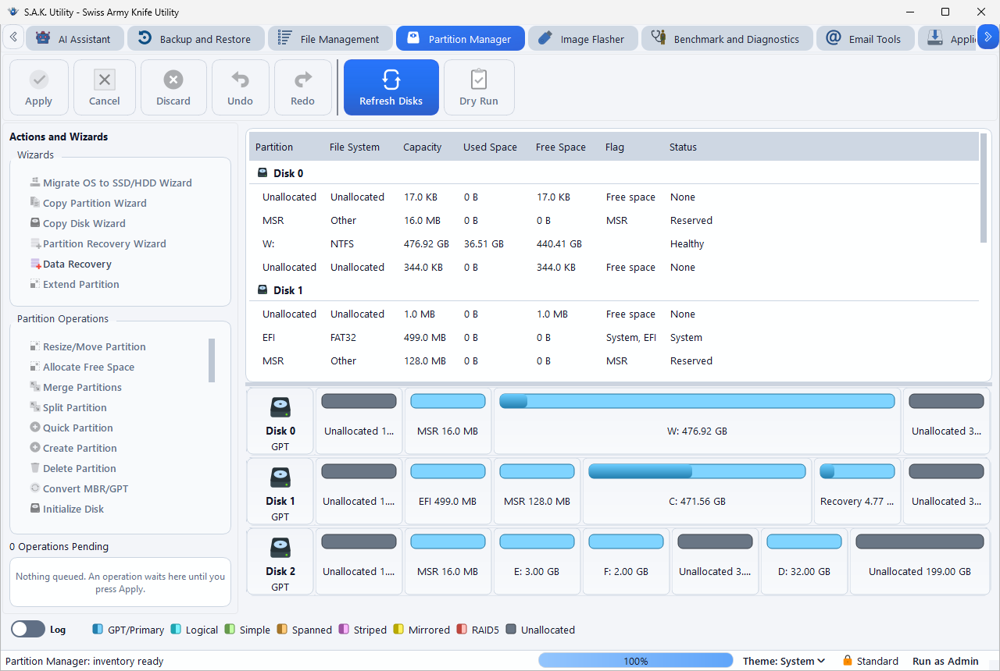
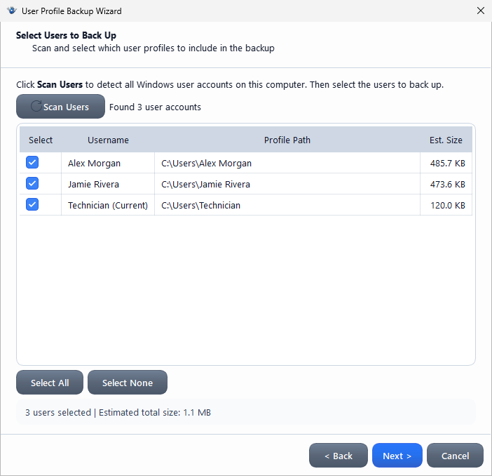
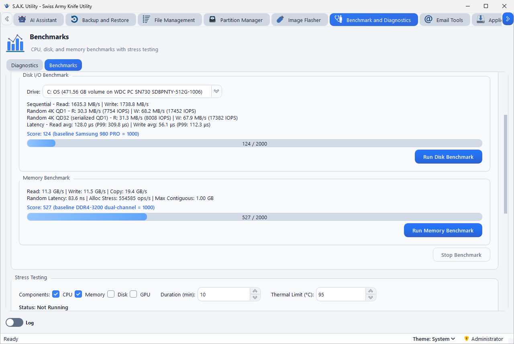
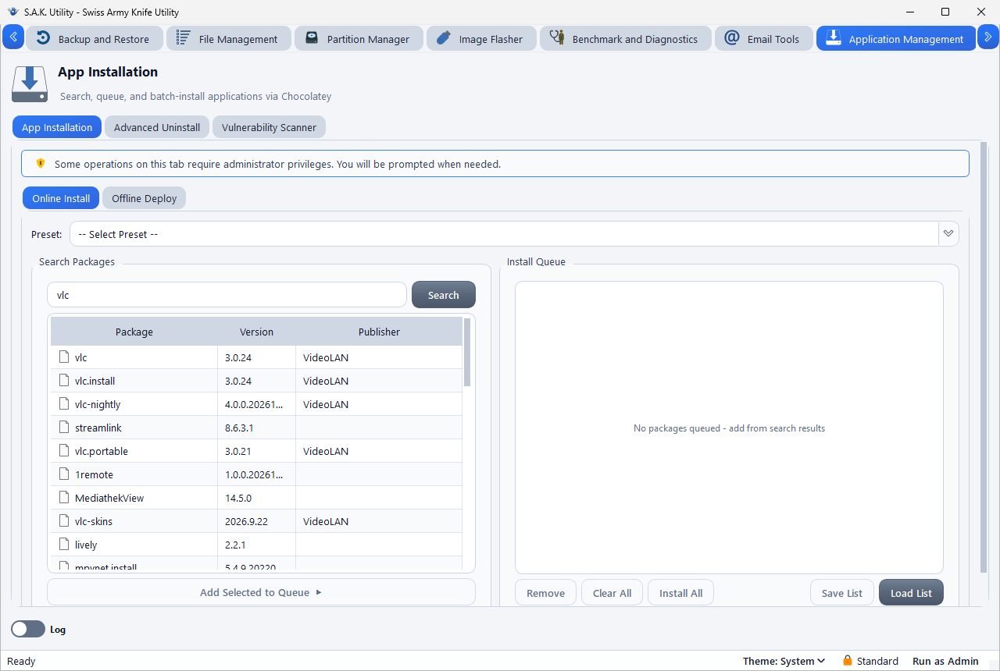
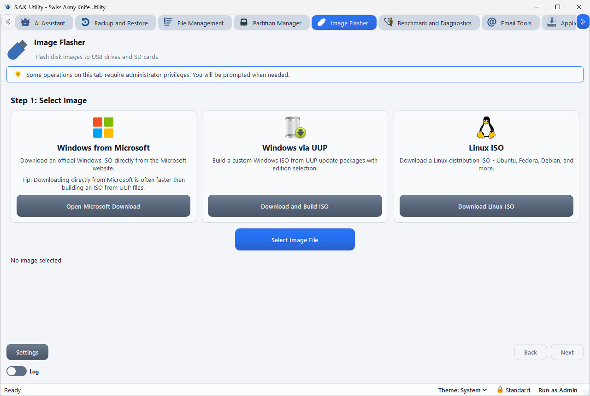
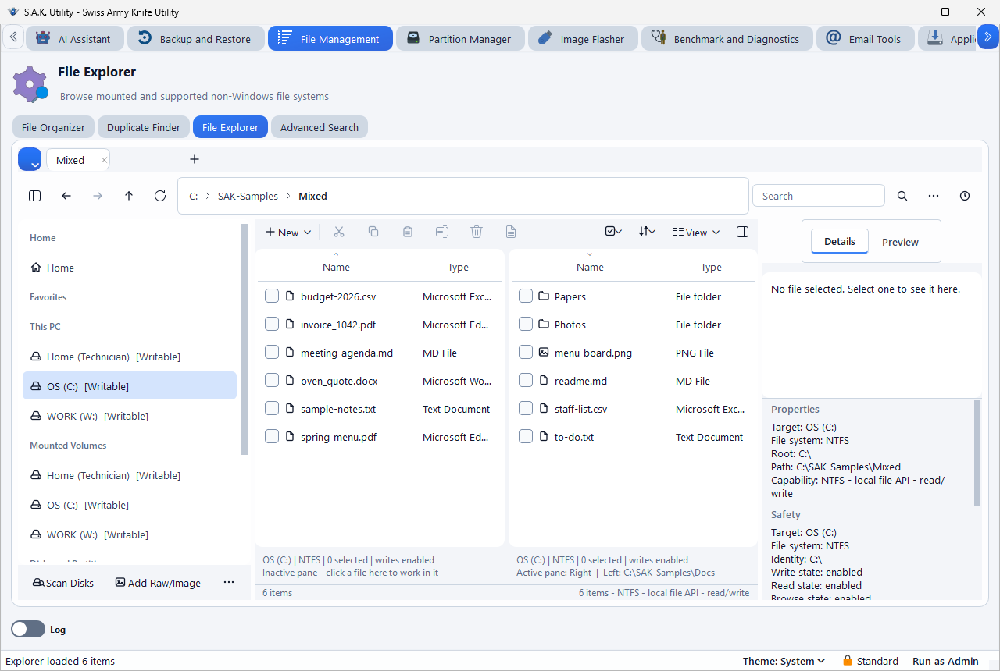
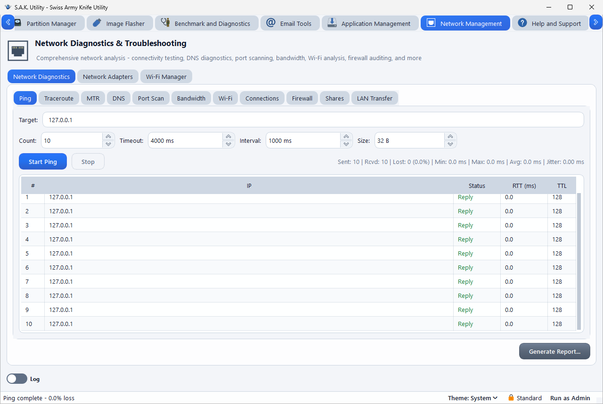
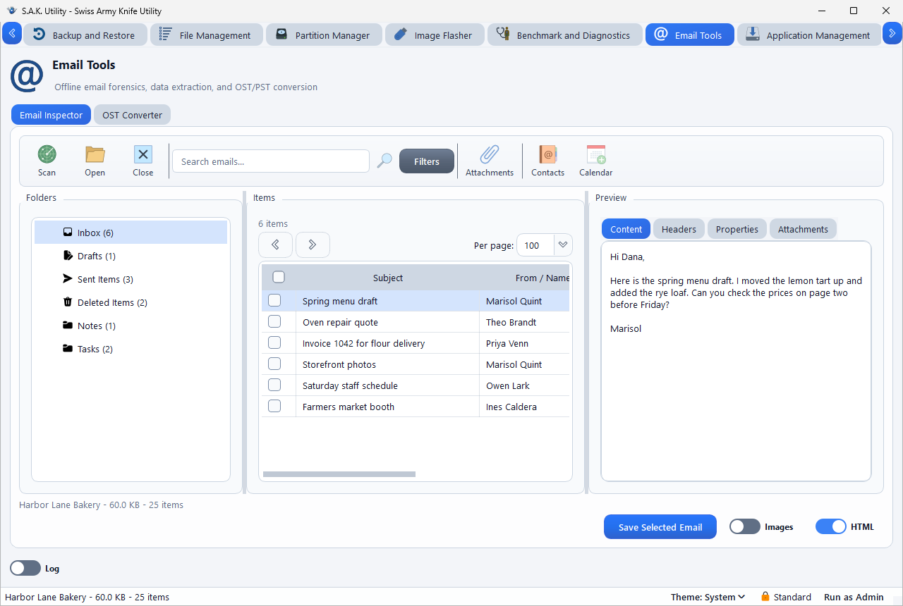

<div align="center">


# S.A.K. Utility

**A free, portable Windows toolkit for PC technicians, IT pros, and sysadmins.**

Backup, partitions, diagnostics, USB imaging, app deployment, network and email tools, and AI repair workflows, in one folder with no installer.

[](https://github.com/RandyNorthrup/S.A.K.-Utility/releases/latest)
[](https://github.com/RandyNorthrup/S.A.K.-Utility/releases)
[](https://github.com/RandyNorthrup/S.A.K.-Utility/stargazers)
[](https://github.com/RandyNorthrup/S.A.K.-Utility/actions/workflows/ci.yml)
[](LICENSE)
[](#requirements)
[](https://discord.gg/pMh2n9kSK3)

**[Download](https://github.com/RandyNorthrup/S.A.K.-Utility/releases/latest/download/SAK-Utility-Windows-x64.zip)** &nbsp;|&nbsp; **[Wiki](https://sakutility.com/wiki)** &nbsp;|&nbsp; **[Website](https://sakutility.com/)** &nbsp;|&nbsp; **[Changelog](CHANGELOG.md)** &nbsp;|&nbsp; **[Discord](https://discord.gg/pMh2n9kSK3)**

</div>

---

## Quick start

1. **[Download the ZIP](https://github.com/RandyNorthrup/S.A.K.-Utility/releases/latest/download/SAK-Utility-Windows-x64.zip)** from the latest release.
2. **Extract it** to a folder you can write to, such as a USB drive or your desktop.
3. **Run `sak_utility.exe`.** It runs as a standard user and asks for administrator rights when a task needs them.

New to it? The **[wiki](https://sakutility.com/wiki)** has a plain-language guide for every tool, with a screenshot of each step.

## Screenshots

<table>
<tr>
<td width="50%"><a href="docs/images/readme/partition-manager.png"></a><br><sub>Partition Manager</sub></td>
<td width="50%"><a href="docs/images/readme/backup-wizard.png"></a><br><sub>Backup Wizard: choosing the profiles to back up</sub></td>
</tr>
<tr>
<td width="50%"><a href="docs/images/readme/benchmarks.png"></a><br><sub>Benchmarks</sub></td>
<td width="50%"><a href="docs/images/readme/app-installation.png"></a><br><sub>App Installation</sub></td>
</tr>
<tr>
<td width="50%"><a href="docs/images/readme/image-flasher.png"></a><br><sub>Image Flasher</sub></td>
<td width="50%"><a href="docs/images/readme/file-explorer.png"></a><br><sub>File Explorer</sub></td>
</tr>
<tr>
<td width="50%"><a href="docs/images/readme/network-diagnostics.png"></a><br><sub>Network Diagnostics</sub></td>
<td width="50%"><a href="docs/images/readme/email-inspector.png"></a><br><sub>Email Inspector</sub></td>
</tr>
</table>

## What's inside

Select a tool to see what it does.

<details>
<summary><b>Backup and Restore</b>: move Windows user profiles to a new PC</summary>

- Guided backup and restore wizards with smart filters
- Optional AES-256 encryption and compression
- Backups can include the installed-app list, app data such as browser profiles and Outlook signatures, and WiFi and Ethernet settings
- Restore maps users, merges into existing profiles, resolves conflicts, and handles permissions (strip, assign, or preserve)
- Quick Tools: Screenshot Settings and BitLocker Key Backup, which warns you if the drive cannot restrict who reads the keys

Guides: [back up a profile](https://sakutility.com/wiki/back-up-user-profile), [restore a profile](https://sakutility.com/wiki/restore-user-profile)
</details>

<details>
<summary><b>Partition Manager</b>: change how a disk is divided, and read Mac and Linux disks</summary>

- Queue changes, then review a before-and-after view before applying them. Dry Run changes nothing
- Wizards: Migrate OS to SSD/HDD, Copy Partition, Copy Disk, Partition Recovery, Data Recovery, Extend Partition
- Resize, move, merge, split, create, delete, and format partitions, and convert between MBR and GPT
- Format, inspect, and browse APFS, HFS+, and ext file systems without a driver
- TRIM, wipe, disk benchmark, space analyzer, defrag, BitLocker status, and bootable media. SSD erase is TRIM plus overwrite, not an ATA or NVMe sanitize

> **Testing:** On the v0.9.3 code, Partition Manager operations, including boot repair, MBR-to-GPT conversion and OS migration, ran through the app on disposable virtual machines and virtual disks. Some operations were also tested on one SAMSUNG MZVL2512HCJQ-00BH1 512 GB NVMe SSD and one Seagate Expansion Desk 8 TB USB disk. Internal SATA drives were not tested, and results on other devices may differ. SSD erase is TRIM plus overwrite, not an ATA or NVMe sanitize. Writes to Apple file systems were validated with Apple's own tools. Back up before changing a disk.
>
> The full record is in [docs/PARTITION_MANAGER_CERTIFICATION.md](docs/PARTITION_MANAGER_CERTIFICATION.md).

Guide: [Partition Manager basics](https://sakutility.com/wiki/partition-manager-basics)
</details>

<details>
<summary><b>Benchmark and Diagnostics</b>: check a PC's health and test its limits</summary>

- SMART drive health and hardware inventory
- CPU, disk, and memory benchmarks, and CPU, memory, disk, and GPU stress tests with temperature monitoring
- Verify System Files, Check Disk Errors, Optimize Power, System Inventory Report, and Run Full Suite
- HTML, JSON, and CSV reports with technician name, ticket number, and notes

Guides: [check drive health](https://sakutility.com/wiki/check-drive-health), [stress test a PC](https://sakutility.com/wiki/stress-test-a-pc)
</details>

<details>
<summary><b>Application Management</b>: install in bulk, work offline, remove properly, check for security holes</summary>

- **App Installation:** search Chocolatey packages or use a preset, then install the whole queue
- **Offline Deploy:** Full or Thin bundles for air-gapped machines, install from a bundle, direct installer downloads
- **Advanced Uninstall:** Win32, Microsoft Store, and provisioned apps, bloatware candidates, orphaned entries, forced uninstall, batch queues, and leftover scans rated by risk
- **Vulnerability Scanner:** checks installed apps against CISA KEV with NVD detail, and looks up one package in CISA KEV, NVD, GitHub Advisories, and OSV, with CSV and JSON export

Guides: [install apps in bulk](https://sakutility.com/wiki/bulk-install-apps), [uninstall with leftover cleanup](https://sakutility.com/wiki/uninstall-with-leftover-cleanup), [scan for vulnerabilities](https://sakutility.com/wiki/scan-software-for-vulnerabilities)
</details>

<details>
<summary><b>Image Flasher</b>: make bootable USB drives</summary>

- Writes ISO, IMG, WIC, and DSK files, and GZ, BZ2, and XZ compressed images
- Builds Windows ISOs from Microsoft UUP files, x64 or ARM64, with edition and language options
- Downloads Linux and recovery images: Ubuntu, Fedora, Debian, Arch, Linux Mint, Kali, SystemRescue, Clonezilla, GParted Live, ShredOS, and Ventoy LiveCD
- System-drive protection, full or quick verification, and several drives at once

A Windows install USB is one FAT32 partition, which UEFI firmware reads. An install.wim of 4 GB or more is split by Windows' own DISM into parts that Windows Setup reads.

Guides: [flash an ISO to USB](https://sakutility.com/wiki/flash-iso-to-usb), [build a Windows ISO](https://sakutility.com/wiki/build-windows-iso)
</details>

<details>
<summary><b>File Management</b>: browse, sort, deduplicate, and search</summary>

- **File Explorer:** tabs, dual pane, folder compare, six view modes, command palette, ZIP tools, and file hashes
- **File Organizer:** sort by extension with preview and collision handling
- **Duplicate Finder:** compares contents with SHA-256 across several folders
- **Advanced Search:** regex, binary and hex, image metadata, PDF and Office metadata, and ZIP and EPUB archives

Guides: [File Explorer](https://sakutility.com/wiki/file-explorer), [find duplicate files](https://sakutility.com/wiki/find-duplicate-files)
</details>

<details>
<summary><b>Network Management</b>: find out why a network is slow or down</summary>

- **Network Diagnostics:** ping, traceroute, MTR, DNS with Compare Servers, port scan, iPerf3 and HTTP bandwidth, WiFi analysis, connections, firewall audit, shares, and LAN Transfer, a speed test between two PCs. Results save as an HTML or JSON report
- **Network Adapters:** details, static IP and DNS, rename, enable or disable, reset the network stack, and back up or restore IP, DNS, gateway, and DHCP settings on any adapter
- **WiFi Manager:** QR codes singly or in batches, Windows setup scripts, and macOS mobileconfig profiles

Guides: [ping, traceroute, and MTR](https://sakutility.com/wiki/ping-traceroute-mtr), [reset the network](https://sakutility.com/wiki/reset-network), [WiFi QR codes](https://sakutility.com/wiki/wifi-qr-codes)
</details>

<details>
<summary><b>Email Tools</b>: open PST, OST, NST, and MBOX archives without Outlook</summary>

- **Email Inspector:** folders, messages, headers, properties, attachments, contacts, calendars, tasks, notes, and journal entries
- Search subjects, bodies, senders, recipients, and attachment names, filter by date, attachment, and item type, and scan a PC for email files
- Export to EML, HTML, TXT, PDF, CSV, VCF, and ICS with attendees and repeating events, and extract attachments in bulk
- **OST Converter:** OST, PST, or NST to MBOX, every real email wherever it is filed, with deleted item recovery, date, sender, and recipient filters, and a count of what it left out by message class

Guides: [open a PST without Outlook](https://sakutility.com/wiki/open-pst-without-outlook), [convert OST to MBOX](https://sakutility.com/wiki/convert-ost-to-mbox)
</details>

<details>
<summary><b>AI Assistant</b>: guided repair jobs and service reports, with your own OpenAI API key</summary>

The assistant is optional. It needs your own OpenAI API key, which OpenAI bills you for. You choose how much it may do:

| Access level | What it can do |
|---|---|
| Chat and Research | Runs nothing on the PC |
| Assisted Full Access | Asks before each command |
| Unattended Full Access | Asks you to confirm when you turn it on, then runs without asking each time, and offers a restore point for risky work. Catastrophic commands always ask |

It can run PowerShell, cmd, and programs, take screenshots, download over HTTPS, search the web, use S.A.K.'s own tools, and control Chrome through a browser extension. Memory is kept per chat. Reports come out as HTML, Markdown, or plain text.

**The 25 built-in workflows:** Full PC Health Check, Drive Health Deep Check, Windows Update Repair, Network Connectivity Repair, BSOD Investigation, Printer Troubleshooting, Startup Performance Triage, Security Advisory Check, Low Disk Space Cleanup Triage, Browser Issue Cleanup, Driver and Device Troubleshooting, Laptop Battery Health, User Profile and Login Repair, Windows Search Index Repair, Audio Device Troubleshooting, Time Sync Repair, Malware and Virus Removal, PC Cleanup, Bloatware, and Adware Review, Approved Bloatware or Adware Removal, Clean Uninstall, Install App Now, Download Offline Installer, Build Offline Deployment Bundle, Technician Tool Assisted Task, and Technician Service Report.

Guides: [set up the AI Assistant](https://sakutility.com/wiki/set-up-ai-assistant), [choose an access level](https://sakutility.com/wiki/ai-access-modes)
</details>

The full list is on the [feature guide](https://sakutility.com/features).

## Requirements

| | |
|---|---|
| **Windows** | 64-bit Windows 11. Windows 10 version 1809 or later meets the minimum, but is not part of release testing |
| **Disk** | About 200 MB, plus working room for the job |
| **Rights** | Standard user. Some tasks ask for administrator rights |
| **Location** | A writable folder. It keeps settings in a `data` folder beside the program, so it will not start from a read-only location such as Program Files |
| **Internet** | Only for tasks that download or look something up |

## Good to know

- **Signed releases.** Official downloads are on [GitHub Releases](https://github.com/RandyNorthrup/S.A.K.-Utility/releases), with a `SHA256SUMS.txt` to check against. To verify, right-click `sak_utility.exe`, then **Properties > Digital Signatures**. The publisher should read Randy Northrup. Windows SmartScreen can still warn about a new release until it builds a reputation.
- **Your data stays local.** Settings, chats, and reports stay in the `data` folder. There is no telemetry. The AI Assistant sends what you give it to OpenAI, using your own key. Your API key is protected with Windows DPAPI, which ties it to your Windows account, so it does not travel with a USB drive.
- **Encryption.** Backups use AES-256-CBC with HMAC-SHA256 authentication and PBKDF2 key derivation. See the [security threat model](docs/SECURITY_THREAT_MODEL.md).

## Build from source

You need Visual Studio 2022 with **Desktop development with C++**, CMake 3.28 or later, Qt 6.12 for MSVC 2022 x64, [vcpkg](https://vcpkg.io/), and Python 3 for the tests.

```powershell
git clone https://github.com/RandyNorthrup/S.A.K.-Utility.git
cd S.A.K.-Utility

# vcpkg installs zlib, bzip2, and liblzma into the build tree, at the versions in vcpkg.json.
cmake -S . -B build -G "Visual Studio 17 2022" -A x64 `
  -DCMAKE_PREFIX_PATH="C:/Qt/6.12.0/msvc2022_64" `
  -DCMAKE_TOOLCHAIN_FILE="$env:VCPKG_ROOT/scripts/buildsystems/vcpkg.cmake" `
  -DVCPKG_TARGET_TRIPLET=x64-windows `
  -DVCPKG_APPLOCAL_DEPS=OFF

cmake --build build --config Release --parallel
ctest --test-dir build -C Release -L product -j 6
.\build\Release\sak_utility.exe
```

Bundled tools live under `tools/`. If one is missing, the `scripts/bundle_*.ps1` scripts fetch it, pinned by hash. Local builds are unsigned; the [release workflow](.github/workflows/release.yml) signs official ones. The AI Assistant is on by default; add `-DSAK_ENABLE_AI_ASSISTANT=OFF` to leave it out.

More for contributors: [CONTRIBUTING.md](CONTRIBUTING.md), [tests/README.md](tests/README.md), and [docs/RELEASE_READINESS.md](docs/RELEASE_READINESS.md).

## Get help

- **How do I...?** Start with the [wiki](https://sakutility.com/wiki).
- **Found a bug or want a feature?** [Open an issue](https://github.com/RandyNorthrup/S.A.K.-Utility/issues).
- **Want to talk?** Join the [Discord](https://discord.gg/pMh2n9kSK3).

## License and credits

S.A.K. Utility is copyright (c) 2025-2026 Randy Northrup and licensed under the [GNU Affero General Public License v3.0](LICENSE).

It stands on [Qt](https://www.qt.io/), [zlib](https://www.zlib.net/), [bzip2](https://sourceware.org/bzip2/), [XZ Utils](https://tukaani.org/xz/), [qrcodegen](https://www.nayuki.io/page/qr-code-generator-library), [smartmontools](https://www.smartmontools.org/), [iPerf3](https://iperf.fr/), [Chocolatey](https://chocolatey.org/), [aria2](https://aria2.github.io/), [UUPMediaCreator](https://github.com/OSTooling/UUPMediaCreator), [wimlib](https://wimlib.net/), and [Icons8](https://icons8.com/) icons, among others. Versions and license texts are in [THIRD_PARTY_LICENSES.md](THIRD_PARTY_LICENSES.md).

Created by [Randy Northrup](https://github.com/RandyNorthrup).
